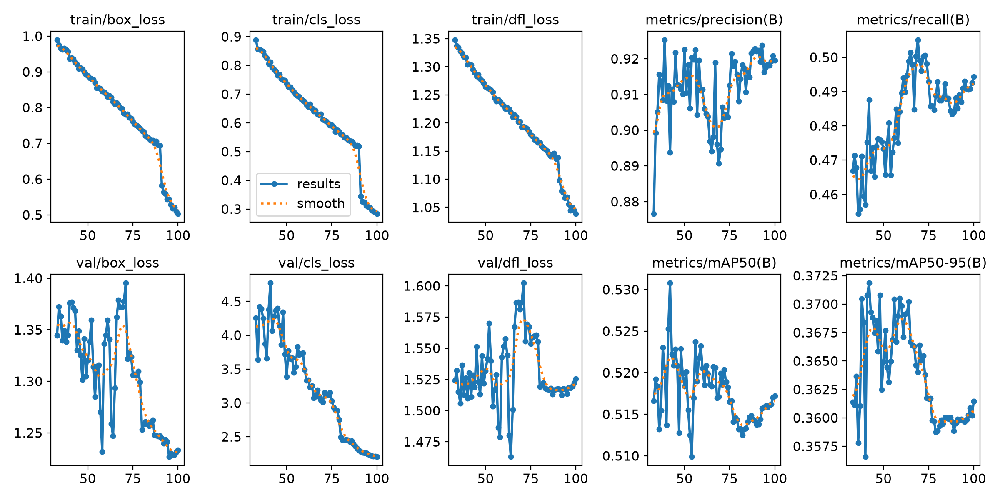
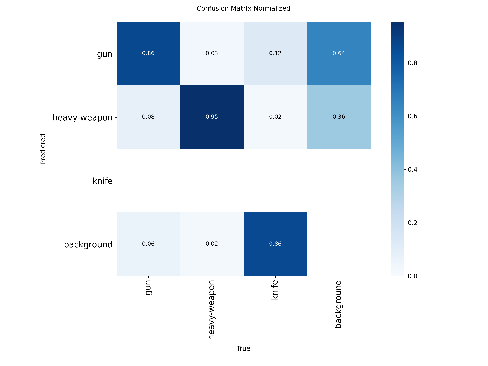
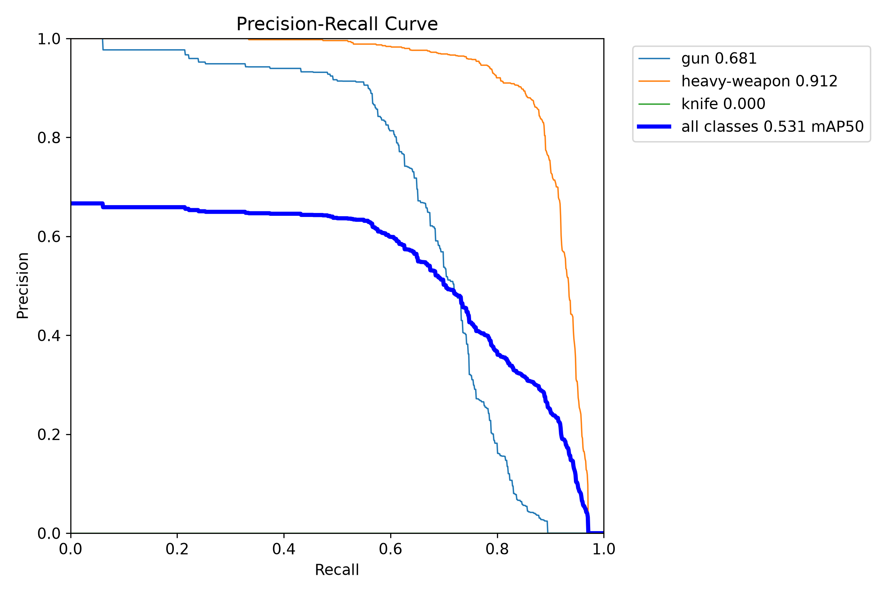
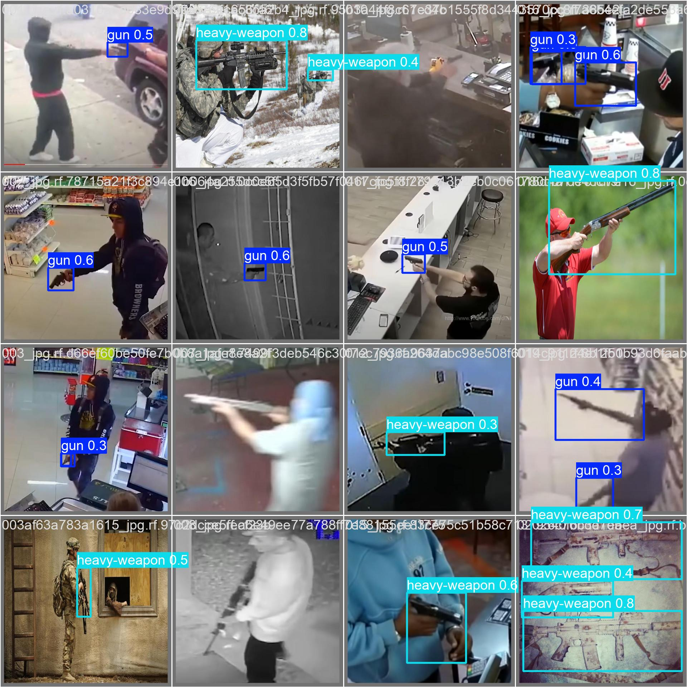

# Real-Time Weapon Detection System

A modular computer vision application that detects weapons in live video using **YOLO11 (Ultralytics)** and **OpenCV**. It runs in two modes: a CLI for webcams and video files, and a **FastAPI web app** that streams your browser camera to a (remote) GPU server, shows live detections, stores alerts in **SQLite**, and sends **email alerts** with snapshots.

> Educational portfolio project. Not intended for safety-critical use.


## Features

- Live detection from a webcam, video file, RTSP stream, or the browser camera
- Custom-trained YOLO11 model with automatic fallback to a pretrained model
- Configurable confidence threshold (default `0.60`)
- Red bounding boxes with `ALERT: <class> (<confidence>%)` labels
- 3-second alert cooldown (debouncing) to prevent disk flooding
- Annotated snapshots saved to `alerts/`
- SQLite alert history with a web dashboard (stats, charts, filter, delete)
- Email alerts with the snapshot attached (SMTP)
- Live UI with FPS, latency, threat counter, alert sound, and a snapshot panel
- Headless mode for servers

## Tech Stack

Python 3.10+, Ultralytics YOLO11, OpenCV, NumPy, FastAPI, WebSockets, SQLite, `uv`

## Project Structure

```
Weapon_Detection/
├── configs/data.yaml            # Example dataset config
├── docs/                        # Demo GIF and result plots
├── scripts/
│   ├── download_dataset.py      # Roboflow dataset download
│   └── train.py                 # Training + deploy best.pt
├── src/weapon_detection/
│   ├── __main__.py              # CLI entry point (weapon-detect)
│   ├── web.py                   # Web server (weapon-serve)
│   ├── app.py                   # CLI pipeline
│   ├── detector.py              # YOLO loading + inference
│   ├── annotator.py             # Boxes, labels, HUD
│   ├── alerts.py                # Cooldown, snapshots, DB, notifications
│   ├── db.py                    # SQLite storage
│   ├── notifier.py              # Email notifications
│   ├── camera.py                # Video source handling
│   ├── config.py                # Settings
│   ├── models.py                # Detection dataclass
│   ├── utils.py                 # FPS counter
│   └── static/
│       ├── index.html           # Live view
│       └── dashboard.html       # Alert dashboard
├── weights/                     # best.pt goes here
├── alerts/                      # Snapshots + alerts.db
└── pyproject.toml
```

## Setup

```bash
git clone https://github.com/0plaze0/Weapon_Detection.git
cd Weapon_Detection
uv sync
cp .env.example .env     # then fill in your values
```

### Model weights

Weights are not stored in git. Download them from the [Releases page](https://github.com/0plaze0/Weapon_Detection/releases):

```bash
mkdir -p weights
wget -O weights/best.pt https://github.com/0plaze0/Weapon_Detection/releases/download/v1.0/best.pt
```

Without `weights/best.pt`, the app falls back to a generic pretrained COCO model for structure testing only.

### Environment variables (`.env`)

```
ROBOFLOW_API_KEY=your_roboflow_key
SMTP_HOST=smtp.gmail.com
SMTP_PORT=587
SMTP_USER=yourname@gmail.com
SMTP_PASSWORD=your_16_char_app_password
ALERT_EMAIL_TO=receiver@example.com
```

For Gmail, enable 2-Step Verification and create an **App Password**. Regular passwords and most institute accounts will not work. Email is optional: if the variables are missing, alerts are still saved and logged.

## Usage

### Web app (works with a remote server)

```bash
uv run weapon-serve --port 9999
```

Open `http://127.0.0.1:9999` and allow camera access.

- Live view: `/`
- Alert dashboard: `/dashboard`

Browsers only allow camera access on `localhost` or HTTPS. On a remote server, use an SSH tunnel or VS Code port forwarding:

```bash
ssh -L 9999:localhost:9999 user@your-server
```

### CLI

```bash
# Webcam (local machine)
uv run weapon-detect --source 0

# Video file, headless, save annotated output
uv run weapon-detect --source test.mp4 --headless --output results/out.mp4
```

| Option | Description | Default |
|---|---|---|
| `--weights` | Custom weights path | `weights/best.pt` |
| `--fallback` | Fallback pretrained model | `yolov8n.pt` |
| `--conf` | Confidence threshold | `0.60` |
| `--cooldown` | Seconds between alerts | `3.0` |
| `--alerts-dir` | Snapshot directory | `alerts` |
| `--source` | Camera index, file, or URL | `0` |
| `--headless` | No display window | off |
| `--output` | Save annotated video | none |

## Training Your Own Model

1. Download the dataset (set `ROBOFLOW_API_KEY` first):
   ```bash
   uv run python scripts/download_dataset.py
   ```
2. Train and deploy to `weights/best.pt`:
   ```bash
   uv run python scripts/train.py --data datasets/weapon-detection-16/data.yaml --model yolo11s.pt --epochs 100
   ```
3. Evaluate:
   ```bash
   uv run yolo detect val model=weights/best.pt data=datasets/weapon-detection-16/data.yaml split=val
   ```

Dataset layout (`configs/data.yaml`):

```yaml
path: ./datasets/weapon-detection-16
train: train/images
val: valid/images
nc: 3
names:
  0: gun
  1: heavy-weapon
  2: knife
```

## Results

**Model:** YOLO11s (9.4M parameters, 21.4 GFLOPs) fine-tuned on a Roboflow weapon detection dataset.
**Evaluated on:** the validation split (1,491 images, 1,540 instances). The dataset has no separate test split, so these numbers are slightly optimistic.

| Class | Images | Instances | Precision | Recall | mAP@0.5 | mAP@0.5:0.95 |
|---|---|---|---|---|---|---|
| **All** | 1491 | 1540 | 0.896 | 0.486 | 0.531 | 0.372 |
| gun | 362 | 396 | 0.789 | 0.613 | 0.681 | 0.430 |
| heavy-weapon | 779 | 920 | 0.898 | 0.847 | 0.911 | 0.685 |
| knife | 195 | 224 | 1.000 | 0.000 | 0.000 | 0.000 |

**Reading the results**

- `heavy-weapon` performs well (mAP@0.5 of 0.911).
- `gun` is reasonable but misses about 4 in 10 instances at the evaluation threshold.
- `knife` is **not detected at all** (recall 0). The model has effectively not learned this class, so knife alerts should not be relied on. Likely causes are label noise, very small or thin objects, or too few usable training examples; the planned fix is to inspect the knife annotations, add more varied knife images, and retrain.
- The overall recall of 0.486 is pulled down by the knife class. Excluding it, recall on the other two classes averages about 0.73.

### Training curves


### Confusion matrix


### Precision-recall curve


### Sample predictions


## How It Works

1. The browser captures webcam frames and sends them as JPEG over a WebSocket.
2. The server decodes each frame and runs YOLO inference.
3. Detections above the confidence threshold are returned as `[x1, y1, x2, y2]`, class, and confidence, and drawn on the page.
4. If a threat is found and the cooldown has elapsed, the server saves the annotated snapshot, writes a row to SQLite, prints a structured log line, and sends an email.

## Deployment

- **GPU server:** run `uv run weapon-serve` and expose it over HTTPS for live demos, for example with `cloudflared tunnel --url http://localhost:9999`.
- **Hugging Face Spaces (Gradio):** a lightweight CPU demo can be hosted for free using the Gradio SDK.
- Free hosting tiers are CPU-only and memory-limited, so expect only a few FPS and an ephemeral disk (the alert database resets on restart).

## Limitations

- The `knife` class is not detected (see Results).
- Performance depends on dataset quality, lighting, camera angle, and distance.
- Toy, airsoft, and real firearms can be confused with each other, and everyday objects can be mislabeled.
- False positives and false negatives are both possible; do not rely on this for real security decisions.
- Single-camera, single-process design; no authentication on the web app.

## Ethics and Disclaimer

This project is for learning and demonstration. Weapon detection systems can produce false alarms with serious consequences, may reflect dataset bias, and raise privacy and surveillance concerns. Use only with consent and in compliance with local law.

## Credits

- [Ultralytics YOLO](https://github.com/ultralytics/ultralytics)
- Dataset: Roboflow Universe, workspace `yolov7test-u13vc`, project `weapon-detection-m7qso`, version 16 (add the license shown on the dataset page)

## License

MIT (add a `LICENSE` file)